<picture>
  <source media="(prefers-color-scheme: dark)" srcset="./assets/banner-dark.svg" />
  <source media="(prefers-color-scheme: light)" srcset="./assets/banner-light.svg" />
  
</picture>

  
  <!--
  
  -->
  

<picture><source media="(prefers-color-scheme: dark)" srcset="./assets/titles/title-about-dark.svg" /><source media="(prefers-color-scheme: light)" srcset="./assets/titles/title-about-light.svg" /></picture>

Hi, I'm Angelito P. Decatoria III, a Software Engineer and Computer Science graduate who builds modern, user-friendly applications. I enjoy turning ideas into software and keep improving my skills through projects.

I'm interested in full-stack development, machine learning, and cloud technologies.

When I'm not coding, you'll probably find me playing Valorant or exploring new technologies.

 

<picture><source media="(prefers-color-scheme: dark)" srcset="./assets/titles/title-stack-dark.svg" /><source media="(prefers-color-scheme: light)" srcset="./assets/titles/title-stack-light.svg" /></picture>

<table>
<tr>

<td valign="top" width="50%">

<picture><source media="(prefers-color-scheme: dark)" srcset="./assets/titles/label-languages-dark.svg" /><source media="(prefers-color-scheme: light)" srcset="./assets/titles/label-languages-light.svg" /></picture>

</td>

<td valign="top" width="50%">

<picture><source media="(prefers-color-scheme: dark)" srcset="./assets/titles/label-frameworks-dark.svg" /><source media="(prefers-color-scheme: light)" srcset="./assets/titles/label-frameworks-light.svg" /></picture>

</td>

</tr>

<tr>

<td valign="top" width="50%">

<picture><source media="(prefers-color-scheme: dark)" srcset="./assets/titles/label-databases-dark.svg" /><source media="(prefers-color-scheme: light)" srcset="./assets/titles/label-databases-light.svg" /></picture>

</td>

<td valign="top" width="50%">

<picture><source media="(prefers-color-scheme: dark)" srcset="./assets/titles/label-tools-dark.svg" /><source media="(prefers-color-scheme: light)" srcset="./assets/titles/label-tools-light.svg" /></picture>

</td>

</tr>

<tr>

<td valign="top" width="50%">

<picture><source media="(prefers-color-scheme: dark)" srcset="./assets/titles/label-ai-dark.svg" /><source media="(prefers-color-scheme: light)" srcset="./assets/titles/label-ai-light.svg" /></picture>

</td>

<td valign="top" width="50%">

<picture><source media="(prefers-color-scheme: dark)" srcset="./assets/titles/label-cloud-dark.svg" /><source media="(prefers-color-scheme: light)" srcset="./assets/titles/label-cloud-light.svg" /></picture>

</td>

</tr>
</table>

<!--
<h3> 🎖︎ Holopin Badges</h3>

-->
