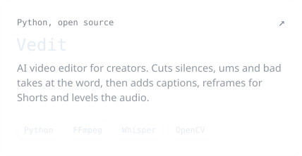
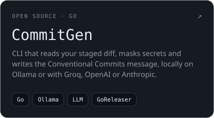
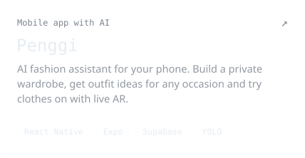
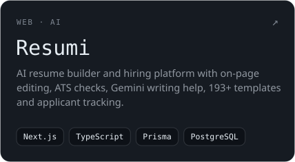
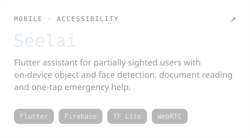
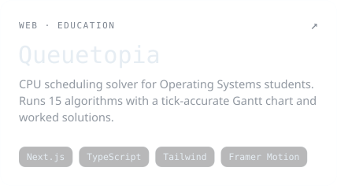
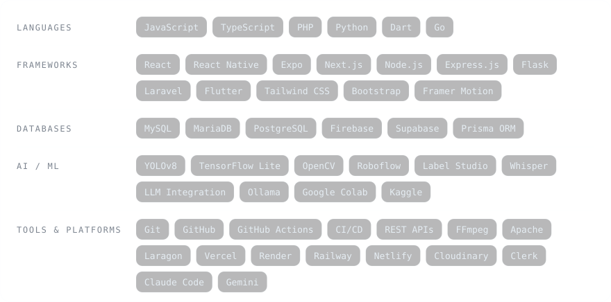

<picture>
  <source media="(prefers-color-scheme: dark)" srcset="./assets/banner-dark.svg" />
  <source media="(prefers-color-scheme: light)" srcset="./assets/banner-light.svg" />
  
</picture>

  <a href="https://angelitodecatoria.com"><picture><source media="(prefers-color-scheme: dark)" srcset="./assets/readme/link-website-dark.svg" /><source media="(prefers-color-scheme: light)" srcset="./assets/readme/link-website-light.svg" /></picture></a>
  <a href="https://www.linkedin.com/in/angelito-decatoria/"><picture><source media="(prefers-color-scheme: dark)" srcset="./assets/readme/link-linkedin-dark.svg" /><source media="(prefers-color-scheme: light)" srcset="./assets/readme/link-linkedin-light.svg" /></picture></a>
  <a href="mailto:angelitodecatoriaa@gmail.com"><picture><source media="(prefers-color-scheme: dark)" srcset="./assets/readme/link-email-dark.svg" /><source media="(prefers-color-scheme: light)" srcset="./assets/readme/link-email-light.svg" /></picture></a>
  <a href="https://angelitodecatoria.com/resume/Angelito_Decatoria_III_Resume.pdf"><picture><source media="(prefers-color-scheme: dark)" srcset="./assets/readme/link-resume-dark.svg" /><source media="(prefers-color-scheme: light)" srcset="./assets/readme/link-resume-light.svg" /></picture></a>

 

<picture><source media="(prefers-color-scheme: dark)" srcset="./assets/readme/title-about-dark.svg" /><source media="(prefers-color-scheme: light)" srcset="./assets/readme/title-about-light.svg" /></picture>

I'm **Angelito P. Decatoria III**, but most people call me **Thirdy**. I'm a full-stack software engineer and Computer Science graduate from Cavite State University, and I build web, mobile and AI products people can rely on.

Lately I've been building open-source developer tools: **[Vedit](https://github.com/onetwothird/Vedit)**, an AI video editor that cuts the pauses and bad takes out of talking-head footage, and **[CommitGen](https://github.com/onetwothird/CommitGen)**, a CLI that writes your commit messages from the staged diff.

When I'm not coding, you'll probably find me playing Valorant or exploring new technologies.

 

<picture><source media="(prefers-color-scheme: dark)" srcset="./assets/readme/title-projects-dark.svg" /><source media="(prefers-color-scheme: light)" srcset="./assets/readme/title-projects-light.svg" /></picture>

  <a href="https://github.com/onetwothird/Vedit"><picture><source media="(prefers-color-scheme: dark)" srcset="./assets/readme/project-vedit-dark.svg" /><source media="(prefers-color-scheme: light)" srcset="./assets/readme/project-vedit-light.svg" /></picture></a>
  <a href="https://github.com/onetwothird/CommitGen"><picture><source media="(prefers-color-scheme: dark)" srcset="./assets/readme/project-commitgen-dark.svg" /><source media="(prefers-color-scheme: light)" srcset="./assets/readme/project-commitgen-light.svg" /></picture></a>

  <a href="https://github.com/onetwothird/Penggi"><picture><source media="(prefers-color-scheme: dark)" srcset="./assets/readme/project-penggi-dark.svg" /><source media="(prefers-color-scheme: light)" srcset="./assets/readme/project-penggi-light.svg" /></picture></a>
  <a href="https://github.com/onetwothird/Resumi"><picture><source media="(prefers-color-scheme: dark)" srcset="./assets/readme/project-resumi-dark.svg" /><source media="(prefers-color-scheme: light)" srcset="./assets/readme/project-resumi-light.svg" /></picture></a>

  <a href="https://github.com/onetwothird/Seelai-App"><picture><source media="(prefers-color-scheme: dark)" srcset="./assets/readme/project-seelai-dark.svg" /><source media="(prefers-color-scheme: light)" srcset="./assets/readme/project-seelai-light.svg" /></picture></a>
  <a href="https://github.com/onetwothird/Queuetopia"><picture><source media="(prefers-color-scheme: dark)" srcset="./assets/readme/project-queuetopia-dark.svg" /><source media="(prefers-color-scheme: light)" srcset="./assets/readme/project-queuetopia-light.svg" /></picture></a>

<a href="https://github.com/onetwothird?tab=repositories">See all repositories →</a>

 

<picture><source media="(prefers-color-scheme: dark)" srcset="./assets/readme/title-stack-dark.svg" /><source media="(prefers-color-scheme: light)" srcset="./assets/readme/title-stack-light.svg" /></picture>

<picture><source media="(prefers-color-scheme: dark)" srcset="./assets/readme/stack-dark.svg" /><source media="(prefers-color-scheme: light)" srcset="./assets/readme/stack-light.svg" /></picture>

 

<picture><source media="(prefers-color-scheme: dark)" srcset="./assets/readme/title-activity-dark.svg" /><source media="(prefers-color-scheme: light)" srcset="./assets/readme/title-activity-light.svg" /></picture>

<picture>
  <source media="(prefers-color-scheme: dark)" srcset="https://raw.githubusercontent.com/onetwothird/onetwothird/output/github-snake-dark.svg" />
  <source media="(prefers-color-scheme: light)" srcset="https://raw.githubusercontent.com/onetwothird/onetwothird/output/github-snake.svg" />
  
</picture>

<!--
<h3> 🎖︎ Holopin Badges</h3>

-->
